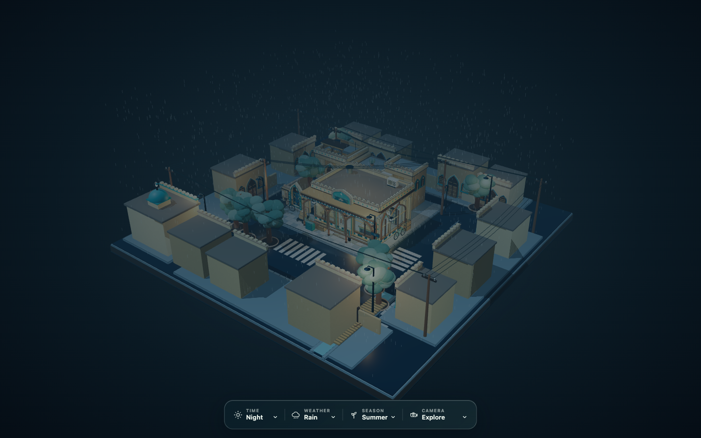

# Uyghur Village



An interactive miniature Uyghur village rendered as a cinematic 3D diorama. Explore a rain-soaked neighborhood with Uyghur architectural details, warm shop interiors, changing weather, seasons, and several camera modes.

## Features

- Day and night lighting
- Clear, rain, snow, and fog weather
- Spring, summer, autumn, and winter seasons
- Explore, 360° orbit, drone, village-walk, and automatic-tour cameras
- Mouse, touch, wheel, and pinch controls
- Self-contained distributable HTML

## Run locally

```bash
pnpm install
pnpm build
```

Open `dist/index.html` in a modern browser. The built file contains the JavaScript and Uyghur font, so it can be shared as a single HTML file.

## Project structure

- `scene.js` — Three.js scene, architecture, weather, animation, and cameras
- `shell.html` — page layout and floating environment controls
- `build.mjs` — bundles everything into one file
- `dist/index.html` — ready-to-open standalone build
